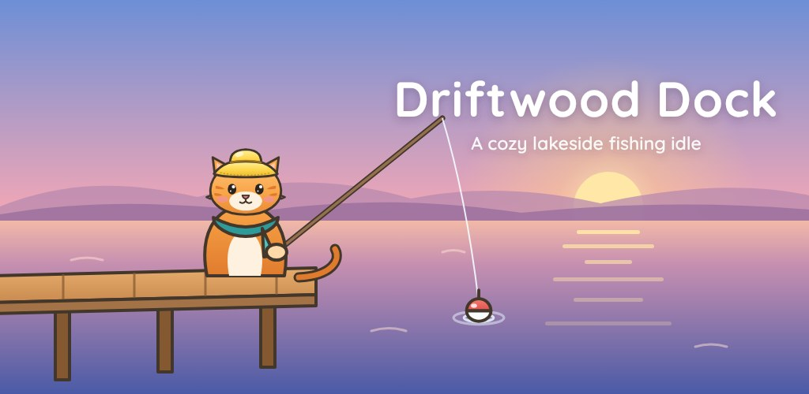
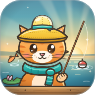
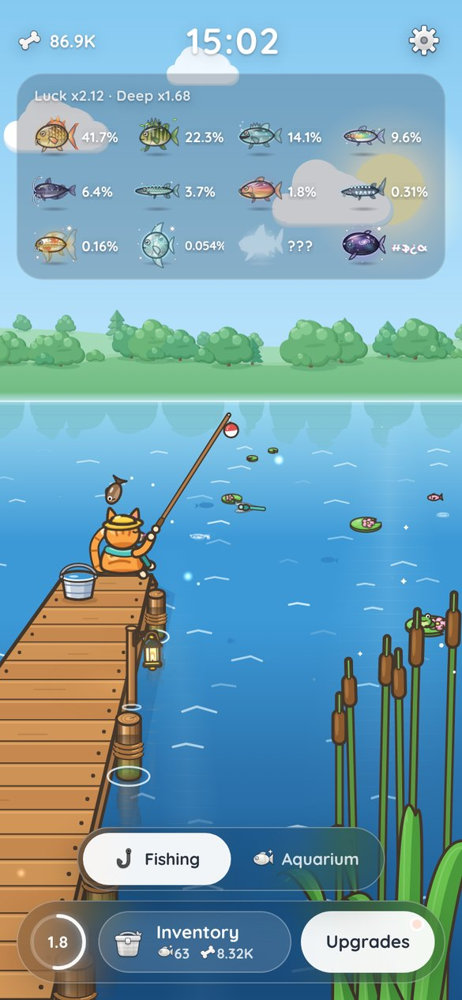
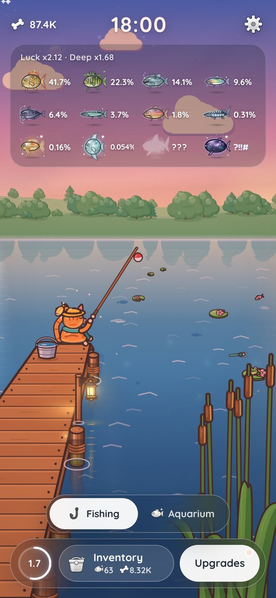
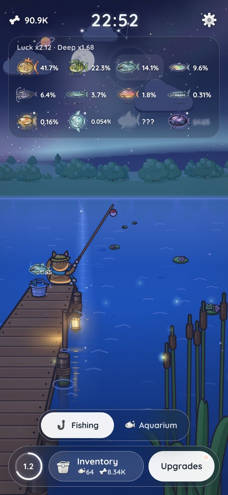
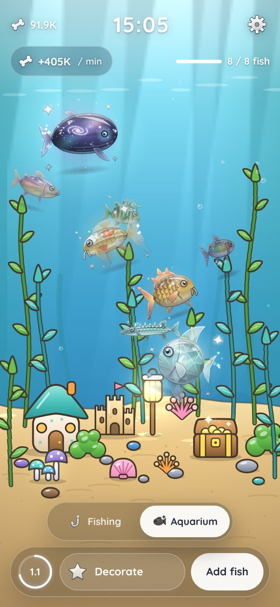
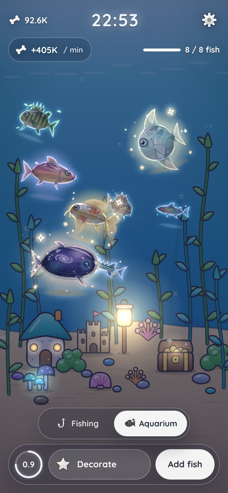
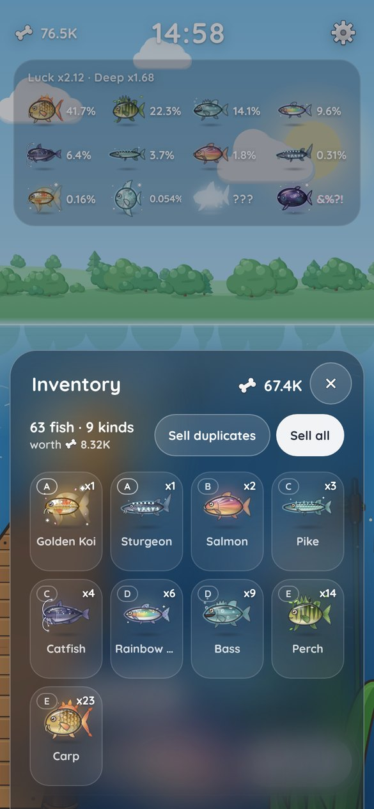
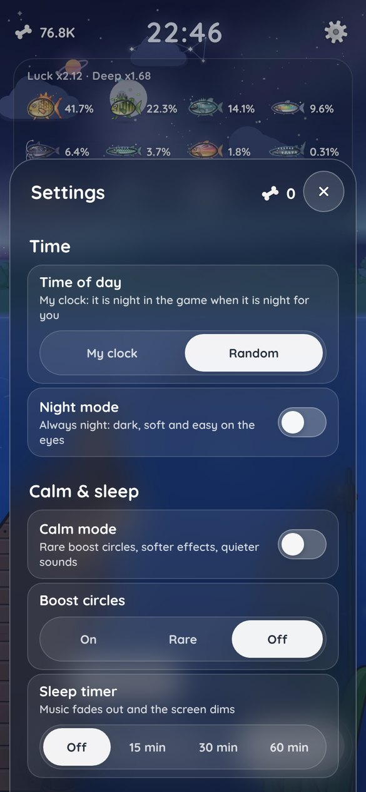

<p align="center"></p>



# Driftwood Dock

A cozy, relaxing, mostly-AFK fishing game for phones. An orange tabby cat in a bucket hat fishes
off a wooden dock while the lake drifts from sunrise to a starry night. Catch fantasy fish, sell
them for bones, upgrade your gear, and keep your favourites in a glowing aquarium. Made to unwind
with, especially at night.

<p align="center">
  
  
  
</p>
<p align="center">
  
  
  
  
</p>

## Download and play

- **Android:** download the APK from [Releases](https://github.com/zqh7y/DriftwoodGame/releases/latest)
  (or from the newest **Android APK** run under [Actions](https://github.com/zqh7y/DriftwoodGame/actions)),
  open it on your phone and allow installing apps from your browser. Step by step: [docs/ANDROID.md](docs/ANDROID.md).
- **In the browser:** [zqh7y.github.io/DriftwoodGame](https://zqh7y.github.io/DriftwoodGame/). On your phone,
  use *Add to Home Screen* and it works like an app, even offline.

## Features

- **A living lake:** a day–night cycle that follows your real clock, weather, a starry night with
  meteors and aurora, a lantern on the dock, reeds that sway, critters and soft ripples.
- **12 fantasy fish**, from the flame-finned Carp to the cosmic Abyss Leviathan, with live odds on
  the board under the clock. The rarest two stay a mystery: "???" and shifting symbols.
- **Mostly AFK:** the cat keeps fishing while you're away. Tap the boost circles on the water to
  speed up a catch if you feel like it.
- **Luck events:** rain, fog and storms raise your luck while they last.
- **Inventory and upgrades:** stack fish, sell them for bones, and upgrade speed, value, luck, hook,
  depth and AFK time.
- **Aquarium:** keep fish in a tank where they swim, play, nap, share little feelings and eat.
  Tap the water to feed them. Fish in the tank earn bones over time; decorate it to earn more.
- **Relaxing sound:** generated lo-fi music, lake ambience and soft effects.
- **Made for night:** night mode, calm mode, a sleep timer that fades the music and dims the screen,
  a battery saver, and separate volume sliders.

## Run it

```bash
npm install
npm run dev        # http://localhost:5173 (hot reload)
npm run build      # typecheck + release build into dist/
npm run artifact   # one self-contained page in artifact/index.html (the shareable preview)
```

Test shortcuts (dev and the preview page only, switched off in `npm run build`):
`#dawn`, `#day`, `#sunset`, `#night` at the end of the URL start the clock at that time.

## Where things live

| Path | What |
|---|---|
| `src/game/upgrades.ts` | Upgrades and **all balance numbers** (costs, growth, effects) |
| `src/game/fish.ts` | The 12 fish: base chances, how luck and Deep shift them, bone values |
| `src/game/game.ts` | Bones, inventory and selling, catch timer, AFK progress, save/load (`localStorage`) |
| `src/ui/` | Game UI (`game-ui.ts`), top bar and clock (`hud.ts`), icons (`icons.ts`, `fishart.ts`) |
| `index.html` | Page shell and all UI styles (tokens at the top of the `<style>`) |
| `src/engine/` | Scene loop, lighting (time of day, weather), palette, drawing helpers |
| `src/layers/` | The world: sky, space, land, water, dock and reeds, fisher (the cat), weather |
| `docs/ART_GUIDE.md` | Art rules and the layer contract for adding to the world |
| `tools/shot.mjs` | Headless screenshots and perf: `node tools/shot.mjs --out shots/x.png --tod night` |

## Game loop

1. The catch timer fills over the catch time (8 s at the start).
2. A fish bites, rolled from the 12 fish's chances (50%, 23%, 12.5% … down to 0.00001%).
   Luck lifts every rarer fish, Deep lifts the six rarest, and bad weather is a luck event
   (rain x1.5, fog x2, storm x3 luck while it lasts). The board under the clock shows the live
   chances; the two rarest show "???" and shifting symbols.
3. The cat reels it in and the fish goes into the inventory; fish of the same kind stack (x12).
4. In the inventory, tap a fish to sell one or all of it, or sell duplicates / everything at once.
   Prices follow your current Fish value and hook, so upgrading also lifts what you already hold.
5. While you're away the cat keeps fishing for up to your AFK time.
6. **Aquarium** (the second screen, Fishing | Aquarium switch above the bar): move fish from the
   inventory into the tank instead of selling them. Each one earns 1% of its sale price per minute
   (x decorations); slots grow from 3 to 12. It keeps earning at a quarter pace while you're away.
   Balance lives in `src/game/aquarium.ts`; the tank is drawn by `src/aquarium/`.

## Android and Google Play

- The game is wrapped as an Android app with Capacitor (`android/`). `npm run android:sync` builds
  the web game and copies it in; `npm run android:icons` regenerates icons and splash screens from
  `resources/`.
- GitHub Actions builds a debug APK on every push (`.github/workflows/android.yml`) and attaches it
  to a Release for `v*` tags. The web version deploys to GitHub Pages from `master`
  (`.github/workflows/pages.yml`).
- Saves use `localStorage`, which persists inside the app. For a Play Store release, see
  [docs/ANDROID.md](docs/ANDROID.md) (signed AAB with `./gradlew bundleRelease`).
